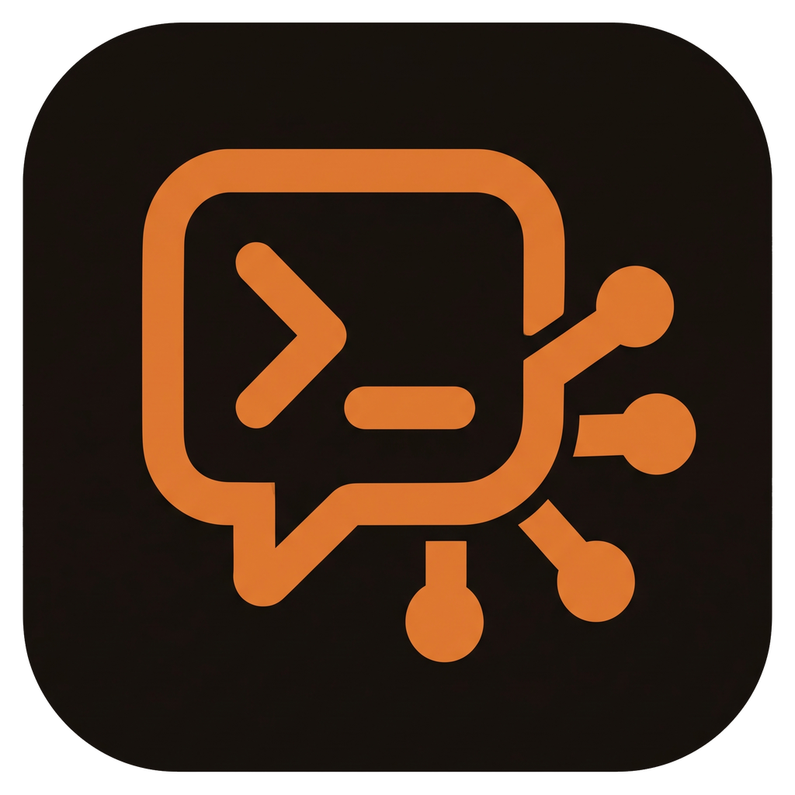

# AI Interface

[Deutsch](README.md) · **English**

A desktop app (Electron) as a control center for working with **Claude Code**: what you have used, what you are
working on, what is running right now, on this PC and on your other computers.

**[Download AI Interface for Windows](https://github.com/GittingBoor/ai-interface/releases/latest/download/AI-Interface-Setup.exe)** (latest version; all versions under
[Releases](https://github.com/GittingBoor/ai-interface/releases))

The exe is not part of this repo's code but attached to the release: right column → **Releases** → latest
version → **Assets** → `AI-Interface-Setup.exe`. This single file is all you need to use the app; you only need the repo
if you want to change the code or build it yourself for Linux.

- **Home:** Most-used projects to continue working on (resumes the last Claude session), open tasks per
  project from the "Open:" field of the newest log (tick them off in the app), numbers of the week, quota and
  quick access.
- **Analytics:** Tokens, API equivalent, hours, prompts and sessions from 7 days up to "All time", split by
  project, computer or model; trends (lines, stacked, 100 %), ranking with drilldown and activity per hour,
  read from `~/.claude/projects/**/*.jsonl` on all connected computers. By default Claude Code deletes sessions
  after 30 days; to keep a long history, raise `cleanupPeriodDays` in `~/.claude/settings.json`.
- **Projects:** Your code folders with categories, color, icon and star. One click starts Claude Code
  (new, resume, shell only) in a terminal of the app, locally or on a device.
- **Terminal:** Several terminals side by side, stacked or in a grid; images to Claude with Ctrl+V;
  desktop notification when Claude needs approval, asks a question or is done.
- **Quota and Open:** 5-hour and weekly quota of the Claude plan (like `/usage`); runs that were aborted at the full
  quota, with "Resume".
- **Devices:** Any number of further computers via SSH (server, mini PC, NAS, Raspberry Pi). Each device gets its
  own page: system values, temperatures, Docker, processes, Claude sessions, Git status, Ollama, folders with a terminal.
- **Notes (optional, Obsidian):** TODO list directly in the vault file (Obsidian Tasks format, lossless) and
  logs from Markdown.
- **Gallery:** Images and screenshots per project; images that Claude generates in a session land automatically
  in the right project.
- **Models and skills:** Claude usage per model, Ollama, custom models; all skills, agents and commands
  (Claude Code, Codex) as a list and chart with an AI summary.
- **Assistant** (Ctrl+J): Claude via your Claude Code sign-in, knows the app data and creates e.g. new projects.
  You have to confirm every change.
- **Orchestrator:** A Claude terminal that takes tasks in plain language and distributes them to Claude terminals in
  your projects.
- **Websites:** Your own pages (e.g. Home Assistant, router, server panel) as a view in the app.
- **Dictation:** Voice input with whisper.cpp, local; the app downloads the program and model itself when needed.
- **Private mode:** Hides private projects everywhere behind a PIN.
- **Languages:** The app itself runs in 7 languages (Deutsch, English, 中文, 日本語, Italiano, Español, Français);
  switch under Settings → Language. The system language is the default.

The sidebar is divided into groups (Work, Notes, AI, Devices, App). You decide the groups, their order and the visible
entries.

## Quick start

**Windows:** Download and run [`AI-Interface-Setup.exe`](https://github.com/GittingBoor/ai-interface/releases/latest/download/AI-Interface-Setup.exe). The installer is not signed; if Windows shows "Windows protected your PC",
click "More info" and then "Run anyway".

The app needs [Claude Code](https://code.claude.com/docs/en/setup) (signed in, Pro/Max plan or API account) and,
on Windows, Git Bash for notifications from the terminals. If anything is missing, the setup assistant shows on first
launch what is still to do, with the matching command.

**From source** (Linux or your own changes; additionally Node.js 22+ and Git):

```bash
git clone https://github.com/GittingBoor/ai-interface.git
cd ai-interface
npm install
npm run dist:win      # Windows: installer under release\
npm run dist:linux    # Linux: AppImage under release/
```

On first launch a **setup assistant** guides you through requirements, project folders, Obsidian (optional)
and devices (optional). Nothing is tailored to a specific computer; you choose all paths there or later in the
settings.

- **Detailed guide:** [`docs/en/SETUP.md`](docs/en/SETUP.md) (installation, assistant, SSH devices,
  Obsidian, customizing, updates, troubleshooting).
- **Have it set up for you:** Give Claude Code the template [`docs/en/CLAUDE-TEMPLATE.md`](docs/en/CLAUDE-TEMPLATE.md). Claude
  checks your computer, agrees projects, categories and devices with you and writes `~/ai-interface-setup.json`.
  The assistant picks up this proposal on first launch. Example:
  [`docs/ai-interface-setup.example.json`](docs/ai-interface-setup.example.json).

## Keyboard shortcuts

| Shortcut | Action |
|---|---|
| Ctrl+K | Command palette: sections, projects, actions |
| Ctrl+J | Assistant on/off |
| Ctrl+1 … Ctrl+8, Ctrl+0 | Analytics, Projects, Terminal, Models, TODOs, Logs, Gallery, Settings, Skills |
| Ctrl+9 | first device |

More shortcuts (terminal, dictation) in the **Controls** section of the app.

## Privacy

The app runs locally. It reads the session files of Claude Code and, for the quota, its sign-in
(`~/.claude/.credentials.json`, read-only; the request goes to `api.anthropic.com`). Data is stored in an
SQLite file in the app data folder (Settings → App). SSH connections use your key or SSH agent;
the app does not store passwords.

## Development

```bash
npm install
npm run dev        # Electron with hot reload
npm run dev:web    # UI only in the browser with sample data (http://127.0.0.1:5199, ?setup shows the assistant)
npm test           # Vitest, runs in Electron's Node (same ABI as the app)
npm run typecheck
npm run build
```

SSH integration tests only run with a test sshd:
`AII_SSH_TEST_KEY=/path/key AII_SSH_TEST_PORT=2299 npm test`.

### Structure

| Path | Contents |
|---|---|
| `src/shared/` | Types, `Result`, IPC contract (`api.ts`), navigation and section layout (`layout.ts`) |
| `src/main/hosts/` | `Host` abstraction: `LocalHost` (file system), `SshHost` (SFTP/SSH), `HostRegistry` (this PC + devices) |
| `src/main/setup/` | Setup: detect folders, vaults and SSH keys, read the proposal file, save the result |
| `src/main/settings/` | Settings in SQLite, defaults, migration of older versions |
| `src/main/usage/` | JSONL parser, sessions, prices, collector, analytics |
| `src/main/todos/`, `src/main/vault/` | TODO file (Obsidian Tasks) and logs from the vault |
| `src/main/terminal/`, `src/main/notify/` | Terminals (node-pty locally, SSH shell on devices), Claude hooks and desktop notifications |
| `src/main/minipc/` | State of a device: system, Docker, Git, Claude sessions |
| `src/main/images/`, `src/main/runs/`, `src/main/quota/` | Gallery, aborted runs, plan quota |
| `src/main/skills/`, `src/main/assistant/` | Skill catalog, AI assistant (Agent SDK, path protection, confirmation) |
| `src/renderer/` | React UI (`views/`, `components/`, `stores/`); `views/setup/` is the setup assistant |
| `tests/` | Vitest tests |

## License

[MIT](LICENSE)
