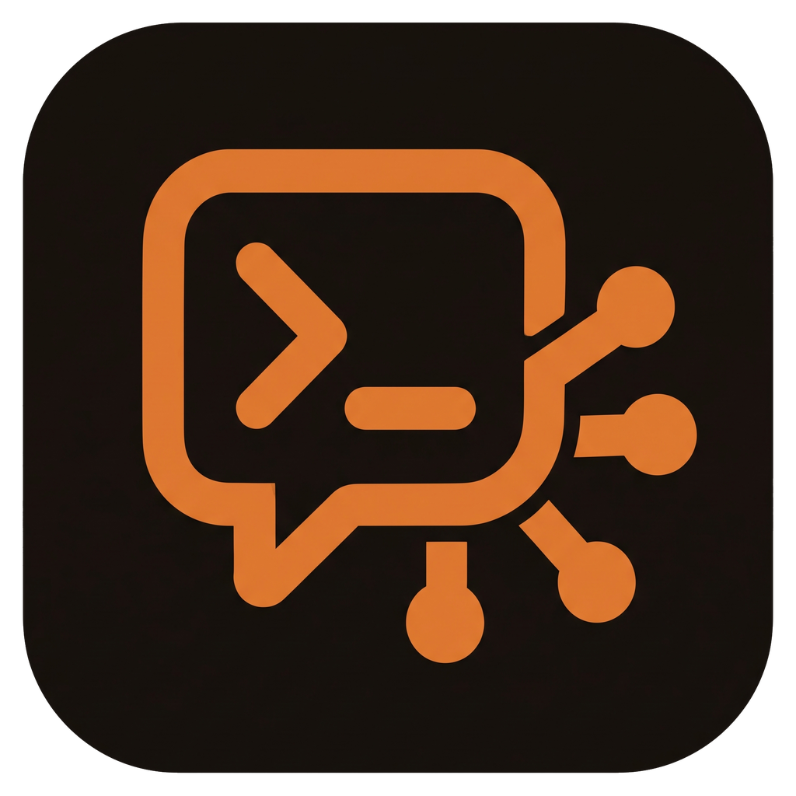

# AI Interface

Eine Desktop-App (Electron) als Steuerzentrale für die Arbeit mit **Claude Code**: Was hast du verbraucht, woran
arbeitest du, was läuft gerade, auf diesem PC und auf deinen anderen Rechnern.

- **Start:** Meistgenutzte Projekte zum Weiterarbeiten (setzt die letzte Claude-Session fort), offene Aufgaben je
  Projekt aus dem Feld „Offen:“ des neuesten Protokolls (in der App abhakbar), Zahlen der Woche, Kontingent und
  Schnellzugriffe.
- **Auswertung:** Token, API-Gegenwert, Stunden, Prompts und Sessions über 7 Tage bis „Gesamt“, aufgeteilt nach
  Projekt, Rechner oder Modell; Verlauf (Linien, gestapelt, 100 %), Ranking mit Drilldown und Aktivität je Stunde,
  gelesen aus `~/.claude/projects/**/*.jsonl` aller angebundenen Rechner. Claude Code löscht Sessions standardmäßig
  nach 30 Tagen; für eine lange Historie `cleanupPeriodDays` in `~/.claude/settings.json` hochsetzen.
- **Projekte:** Deine Code-Ordner mit Arten (Kategorien), Farbe, Symbol und Stern. Ein Klick startet Claude Code
  (neu, fortsetzen, nur Shell) in einem Terminal der App, lokal oder auf einem Gerät.
- **Terminal:** Mehrere Terminals nebeneinander, untereinander oder im Raster; Bilder per Strg+V an Claude;
  Desktop-Meldung, wenn Claude eine Freigabe braucht, fragt oder fertig ist.
- **Kontingent und Offen:** 5-Stunden- und Wochenkontingent des Claude-Abos (wie `/usage`); Durchläufe, die am vollen
  Kontingent abgebrochen sind, mit „Fortsetzen“.
- **Geräte:** Beliebig viele weitere Rechner per SSH (Server, Mini-PC, NAS, Raspberry Pi). Jedes Gerät bekommt eine
  eigene Seite: Systemwerte, Temperaturen, Docker, Prozesse, Claude-Sitzungen, Git-Stand, Ollama, Ordner mit Terminal.
- **Notizen (optional, Obsidian):** TODO-Liste direkt in der Vault-Datei (Obsidian-Tasks-Format, verlustfrei) und
  Protokolle aus Markdown.
- **Galerie:** Bilder und Screenshots je Projekt; Bilder, die Claude in einer Session erzeugt, landen automatisch
  beim richtigen Projekt.
- **Modelle und Skills:** Claude-Nutzung je Modell, Ollama, eigene Modelle; alle Skills, Agents und Befehle
  (Claude Code, Codex) als Liste und Grafik mit KI-Zusammenfassung.
- **Assistent** (Strg+J): Claude über dein Claude-Code-Login, kennt die App-Daten und legt z. B. neue Projekte an.
  Jede Änderung musst du bestätigen.
- **Orchestrator:** Ein Claude-Terminal, das Aufträge in Umgangssprache entgegennimmt und an Claude-Terminals in
  deinen Projekten verteilt.
- **Webseiten:** Eigene Seiten (z. B. Home Assistant, Router, Server-Panel) als Ansicht in der App.
- **Diktat:** Spracheingabe mit whisper.cpp, lokal; Programm und Modell lädt die App bei Bedarf selbst.
- **Privatmodus:** Blendet private Projekte per PIN überall aus.

Die Seitenleiste ist in Gruppen geteilt (Arbeiten, Notizen, KI, Geräte, App). Gruppen, Reihenfolge und sichtbare
Einträge legst du selbst fest.

## Schnellstart

Voraussetzungen: [Claude Code](https://code.claude.com/docs/en/setup) (angemeldet, Pro-/Max-Abo oder
API-Konto), Node.js 22+, Git. Gebaut wird für Windows (Installer) und Linux (AppImage).

```bash
git clone https://github.com/GittingBoor/ai-interface.git
cd ai-interface
npm install
npm run dist:win      # Windows: Installer unter release\
npm run dist:linux    # Linux: AppImage unter release/
```

Beim ersten Start führt ein **Einrichtungsassistent** durch Projektordner, Obsidian (optional) und Geräte
(optional). Nichts ist auf einen bestimmten Rechner zugeschnitten; alle Pfade wählst du dort oder später in den
Einstellungen.

- **Ausführliche Anleitung:** [`docs/EINRICHTUNG.md`](docs/EINRICHTUNG.md) (Installation, Assistent, SSH-Geräte,
  Obsidian, Anpassen, Updates, Fehlersuche).
- **Einrichten lassen:** Gib Claude Code die Vorlage [`docs/CLAUDE-TEMPLATE.md`](docs/CLAUDE-TEMPLATE.md). Claude
  prüft deinen Rechner, stimmt Projekte, Arten und Geräte mit dir ab und schreibt `~/ai-interface-setup.json`.
  Der Assistent übernimmt diesen Vorschlag beim ersten Start. Beispiel:
  [`docs/ai-interface-setup.example.json`](docs/ai-interface-setup.example.json).

## Tastenkürzel

| Kürzel | Wirkung |
|---|---|
| Strg+K | Befehlspalette: Bereiche, Projekte, Aktionen |
| Strg+J | Assistent ein/aus |
| Strg+1 … Strg+8, Strg+0 | Auswertung, Projekte, Terminal, Modelle, TODOs, Protokolle, Galerie, Einstellungen, Skills |
| Strg+9 | erstes Gerät |

Weitere Kürzel (Terminal, Diktat) im Bereich **Steuerung** der App.

## Datenschutz

Die App läuft lokal. Sie liest die Session-Dateien von Claude Code und für das Kontingent dessen Anmeldung
(`~/.claude/.credentials.json`, nur lesend; die Abfrage geht an `api.anthropic.com`). Daten liegen in einer
SQLite-Datei im App-Datenordner (Einstellungen → App). SSH-Verbindungen nutzen deinen Schlüssel oder SSH-Agent;
Passwörter speichert die App nicht.

## Entwicklung

```bash
npm install
npm run dev        # Electron mit Hot Reload
npm run dev:web    # nur Oberfläche im Browser mit Beispieldaten (http://127.0.0.1:5199, ?setup zeigt den Assistenten)
npm test           # Vitest, läuft in Electrons Node (gleiche ABI wie die App)
npm run typecheck
npm run build
```

SSH-Integrationstests laufen nur mit einem Test-sshd:
`AII_SSH_TEST_KEY=/pfad/key AII_SSH_TEST_PORT=2299 npm test`.

### Aufbau

| Pfad | Inhalt |
|---|---|
| `src/shared/` | Typen, `Result`, IPC-Vertrag (`api.ts`), Navigation und Abschnitts-Layout (`layout.ts`) |
| `src/main/hosts/` | `Host`-Abstraktion: `LocalHost` (Dateisystem), `SshHost` (SFTP/SSH), `HostRegistry` (dieser PC + Geräte) |
| `src/main/setup/` | Einrichtung: Ordner, Vaults und SSH-Schlüssel erkennen, Vorschlagsdatei lesen, Ergebnis speichern |
| `src/main/settings/` | Einstellungen in SQLite, Standardwerte, Übernahme älterer Versionen |
| `src/main/usage/` | JSONL-Parser, Sessions, Preise, Sammler, Auswertung |
| `src/main/todos/`, `src/main/vault/` | TODO-Datei (Obsidian Tasks) und Protokolle aus dem Vault |
| `src/main/terminal/`, `src/main/notify/` | Terminals (node-pty lokal, SSH-Shell auf Geräten), Claude-Hooks und Desktop-Meldungen |
| `src/main/minipc/` | Zustand eines Geräts: System, Docker, Git, Claude-Sitzungen |
| `src/main/images/`, `src/main/runs/`, `src/main/quota/` | Galerie, abgebrochene Durchläufe, Abo-Kontingent |
| `src/main/skills/`, `src/main/assistant/` | Skill-Katalog, KI-Assistent (Agent SDK, Pfadschutz, Bestätigung) |
| `src/renderer/` | React-Oberfläche (`views/`, `components/`, `stores/`); `views/setup/` ist der Einrichtungsassistent |
| `tests/` | Vitest-Tests |

Design und Architektur: [`docs/superpowers/specs/`](docs/superpowers/specs/).

### TODO-Format

```markdown
## Server
- [ ] Backup prüfen ⏫ 📅 2026-10-01
  Notiz (eingerückt)
- [x] Updates eingespielt ✅ 2026-09-20
```

`⏫` = hoch, `🔽` = niedrig, `📅` = fällig, `✅` = erledigt am. Überschriften sind die Gruppen.
Alle anderen Zeilen der Datei bleiben beim Schreiben unverändert.

## Lizenz

[MIT](LICENSE)
